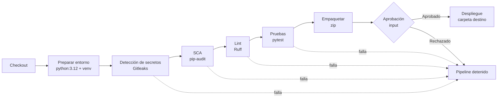
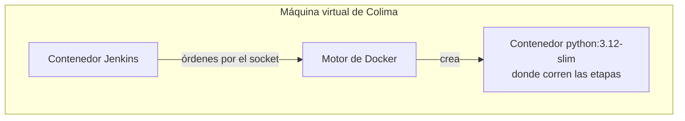
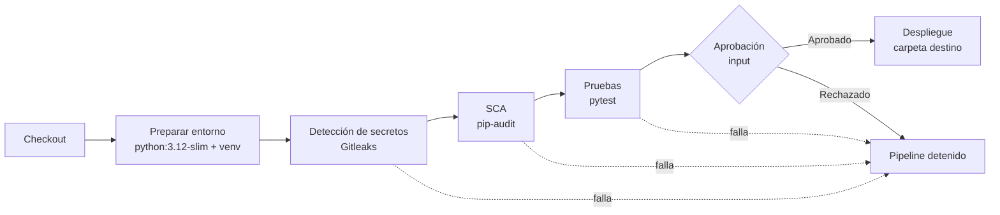

# Desarrollo del reto: Optimización de flujos de despliegue en un entorno de datos

---

## Fase 0: Configuración del proyecto

### Problemas encontrados y cómo se resolvieron

| # | Problema | Causa | Solución |
|---|---|---|---|
| 1 | `ERROR: No matching distribution found for Jenkins==2.346` al instalar `requirements.txt` | La librería `Jenkins` no existe en PyPI. Jenkins es la herramienta que ejecuta el pipeline, no una dependencia de Python. | Se eliminó de `requirements.txt` |
| 2 | `pytest` estaba en `requirements.txt` | `pytest` no se requiere en producción; es para desarrollo, para probar el código. | Se creó `requirements-dev.txt` (incluye `-r requirements.txt` + `pytest`) |
| 3 | `pytest` falla con `ModuleNotFoundError: No module named 'src'` | Sin `tests/__init__.py`, pytest agrega `tests/` a `sys.path` y no encuentra `src` | Se agregó `tests/__init__.py`; ahora la raíz del proyecto queda en `sys.path` |

### Aprendizajes

- La regla de "subir hasta no encontrar `__init__.py`" es de pytest, no de Python.
- `python src/main.py` pone `src/` en `sys.path`; `python -m src.main` pone la carpeta desde donde se ejecuta.
- Los `__init__.py` se suben al repositorio; `.venv/` y `__pycache__/` no.

---

## Fase 1: Exploración del entorno de despliegue

### 1. Contexto y alcance

Se analiza el proceso de despliegue de productos de datos que incluyen desde infraestructura y procesamiento (dbt o Glue) hasta orquestación en Airflow, basado en el conocimiento adquirido al trabajar con el cliente.

### 2. Pipeline actual en la organización (Azure DevOps)

#### Herramientas y destino

- **Herramienta de CI/CD:** Azure DevOps Pipelines
- **Nube:** los productos de datos se despliegan en AWS.
- Se despliegan distintos componentes según la necesidad de cada producto de datos.

#### Componentes que se despliegan

| Componente | Herramienta / servicio | CI | CD |
|---|---|---|---|
| Infraestructura | Terraform, que despliega componentes en AWS | Detección de secretos con Gitleaks y TruffleHog, entre otras validaciones | Requiere aprobaciones |
| DAGs | Airflow (MWAA) como orquestador | Gitleaks, configuración de versión de Python, dependencias de MWAA, linters | Gitleaks y el despliegue del DAG |
| Código de Glue | AWS Glue | Detección de secretos con Gitleaks y ejecución de pruebas con cobertura, entre otras validaciones | Aprobación para producción (Approval PDN) y otra validación con Gitleaks |
| Proyectos dbt | dbt (serverless) | Detección de secretos con Gitleaks, inspección del proyecto dbt y carga de los modelos a un S3 temporal | Validación con Gitleaks; los modelos se ejecutan desde Airflow |

#### Proceso de ejecución

- El pipeline **no se ejecuta automáticamente** al hacer merge: una persona entra a Azure DevOps, busca su pipeline y lo ejecuta (Continuous Delivery manual).
- Hay **aprobaciones por seguridad**: debe existir un responsable que verifique qué se va a desplegar antes de que el pipeline continúe.

#### Seguridad y Calidad

- Se hace uso de credenciales temporales de AWS.
- Se ejecuta Gitleaks para detectar secretos en el código.
- Uso de herramientas como Checkov y TFLint para Terraform
- Uso de Sonar para analisis de calidad de codigo


---

## Fase 2: Diseño de un pipeline de despliegue optimizado

### 1. Punto de partida

El `pipelines/Jenkinsfile` original tiene tres etapas:

| Etapa | Qué hace |
|---|---|
| Compilación | Solo imprime un texto (`echo`) |
| Pruebas | Ejecuta `pytest` |
| Despliegue | Ejecuta `python src/main.py` en la máquina de Jenkins |


### 2. Decisiones de diseño

| Decisión | Elección | Justificación |
|---|---|---|
| Herramienta de CI/CD | **Jenkins** | Es la herramienta del repositorio del reto y permite aprender una herramienta nueva, ya que no la he usado antes |
| Qué se despliega | **El proyecto del reto tal cual** (script de Python) | No se requiere generar un producto de datos como se hace actualmente; la idea es demostrar que se puede tener un despliegue |
| Entorno de ejecución | **Contenedor Docker `python:3.12`** | Garantiza la misma versión de Python en cualquier máquina o agente, evitando el "en mi máquina funciona" |
| Artefacto | **Archivo `.zip`** con `src/` y `requirements.txt` | Normalmente prefiero empaquetar todo en una imagen Docker, porque es fácil de replicar, pero para esta actividad un zip es rápido y sencillo |
| Destino del despliegue | **Una carpeta local** que simula el entorno de destino | Mantiene el pipeline ejecutable en local sin depender de una nube |
| Orden de las validaciones | **Secretos → SCA → Lint → Pruebas** | Primero lo más grave: una filtración de información sensible puede comprometer datos de clientes y de la empresa, y además es una validación rápida. Luego las vulnerabilidades en dependencias (seguridad) y después la calidad del código (lint y pruebas) |

### 3. Etapas del pipeline

| # | Etapa | Herramienta | Qué hace | Por qué existe |
|---|---|---|---|---|
| 0 | Checkout | `checkout scm` | Descarga el código del repositorio | Punto de partida del pipeline |
| 1 | Preparar entorno | `python:3.12` + venv | Crea el entorno virtual e instala `requirements-dev.txt` | Automatiza lo que en la Fase 0 se hizo a mano; en un clon limpio no hay dependencias |
| 2 | Detección de secretos | Gitleaks | Busca contraseñas, tokens, IPs u otra información sensible en el código | Evitar exponer información sensible. Es la misma herramienta usada en la organización |
| 3 | SCA | pip-audit | Revisa si las dependencias tienen vulnerabilidades conocidas (CVE) | El código también está compuesto por librerías de terceros, que pueden tener fallos de seguridad |
| 4 | Lint | Ruff | Valida sintaxis y buenas prácticas del código | Reemplaza la etapa "Compilación" del original, que no validaba nada |
| 5 | Pruebas | pytest + reporte JUnit | Ejecuta las pruebas y publica el resultado en Jenkins | Detectar si un cambio rompió algo |
| 6 | Empaquetar | zip + `archiveArtifacts` | Genera el artefacto y lo guarda en Jenkins | *Build once, deploy many*: lo que se probó es exactamente lo que se despliega |
| 7 | Aprobación | `input` | Pausa el pipeline hasta que una persona lo apruebe | Control humano antes de desplegar, como la aprobación usada en la organización |
| 8 | Despliegue | Copia + `python -m src.main` | Copia el artefacto a la carpeta de destino, lo descomprime y lo ejecuta | Llevar el artefacto a un entorno distinto al de construcción. Se usa `-m` para ejecutar igual que en las pruebas |
| — | `post` (bloque final) | `always` / `failure` | Se ejecuta al terminar el pipeline, haya salido bien o mal (como el `finally` en Python). Publica el reporte de pruebas, borra archivos temporales y avisa si algo falló | Saber qué pasó en cada ejecución y evitar que archivos de una ejecución anterior afecten a la siguiente |

### 4. Diagrama


---

## Fase 3: Implementación y validación del pipeline de despliegue

### 1. Entorno de ejecución: Jenkins en Docker

Para ejecutar el `Jenkinsfile` se necesita un servidor de Jenkins. Se levanta en local con Docker (sobre Colima), usando los archivos de `infra/jenkins/`:

| Archivo | Qué hace |
|---|---|
| `Dockerfile` | Parte de la imagen oficial `jenkins/jenkins:lts-jdk21` y le agrega el cliente de Docker (`docker-ce-cli`) y los plugins `workflow-aggregator`, `git`, `docker-workflow` y `junit` |
| `docker-compose.yml` | Levanta Jenkins en el puerto **8081** (el 8080 ya estaba ocupado), con un volumen persistente para su configuración y acceso al socket de Docker |

Para levantarlo, desde `infra/jenkins/`:

```bash
docker compose up -d --build
```

#### Arquitectura

A través del contenedor de Jenkins se interactúa con Docker para crear contenedores. Jenkins no tiene un motor de Docker propio: usa el de Colima a través del socket (`/var/run/docker.sock`). Este patrón se conoce como *Docker-outside-of-Docker*.



#### Decisiones de seguridad

| Decisión | Justificación |
|---|---|
| Imagen base oficial de Jenkins | Reduce el riesgo de usar una imagen alterada (cadena de suministro) |
| Instalar Docker con su llave GPG oficial | Verifica que el paquete realmente viene de Docker |
| Volver al usuario `jenkins` después de instalar | No dejar la imagen corriendo como `root` |
| Dar acceso al socket de Docker agregando el usuario `jenkins` al grupo dueño del socket (`group_add`, grupo 991), en lugar de ejecutar Jenkins como `root` | Principio de mínimo privilegio: Jenkins recibe solo el permiso que necesita (usar Docker) y no control total del contenedor |


### 2. Configuración del job en Jenkins

| Campo | Valor |
|---|---|
| Tipo | Pipeline |
| Definition | **Pipeline script from SCM** (SCM = *Source Code Management*, en este caso Git). Jenkins lee el pipeline desde el repositorio (`pipelines/Jenkinsfile`) en lugar de escribirlo en la interfaz de Jenkins. Así el pipeline tiene historial de cambios y vive junto al código (*Pipeline as Code*) |
| Repositorio | `https://github.com/cristianrojas96/challenge-DevSecOps.git` (público, sin credenciales) |
| Rama | `*/main` |
| Script Path | `pipelines/Jenkinsfile` |

### 3. Antes: ejecución del Jenkinsfile original (build #1)

Resultado: ❌ **FAILURE**

| Etapa | Resultado | Observación |
|---|---|---|
| Compilación | 🟢 Pasó | Solo ejecuta un `echo`: sale en verde sin validar nada |
| Pruebas | 🔴 Falló | `pytest: not found` (código de salida 127: comando no encontrado) |
| Despliegue | ⚪ Omitida | Se saltó por el fallo anterior |

```
+ pytest
.../script.sh.copy: 1: pytest: not found
ERROR: script returned exit code 127
Finished: FAILURE
```

### 4. Pipeline implementado

Resultado: ✅ **SUCCESS**



| Etapa | Contenedor | Qué hace |
|---|---|---|
| Preparar entorno | `python:3.12-slim` | Crea el `.venv` e instala `requirements-dev.txt` |
| Detección de secretos | `ghcr.io/gitleaks/gitleaks:v8.30.1` | Revisa todo el historial de commits buscando secretos. Con `--redact`, si encuentra uno no lo muestra en el log |
| SCA | `python:3.12-slim` | pip-audit revisa si las dependencias tienen vulnerabilidades conocidas |
| Pruebas | `python:3.12-slim` | Ejecuta `python -m pytest` y genera el reporte JUnit |
| Despliegue | `python:3.12-slim` | Pide aprobación manual (con un tiempo límite de 30 minutos). Si se aprueba, copia solo `src/` y `requirements.txt` a la carpeta de destino y ejecuta `python -m src.main` |

Cada etapa corre en su propio contenedor, que se destruye al terminar; la carpeta de trabajo (con el `.venv`) se comparte entre etapas. Si cualquier etapa falla, el pipeline se detiene y no se despliega.

Durante la implementación, la etapa SCA detectó una vulnerabilidad real (**PYSEC-2026-1845**) en `pytest 7.1.2`, que venía en el proyecto original. Se corrigió actualizando a `pytest 9.0.3`.
